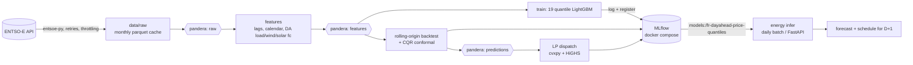
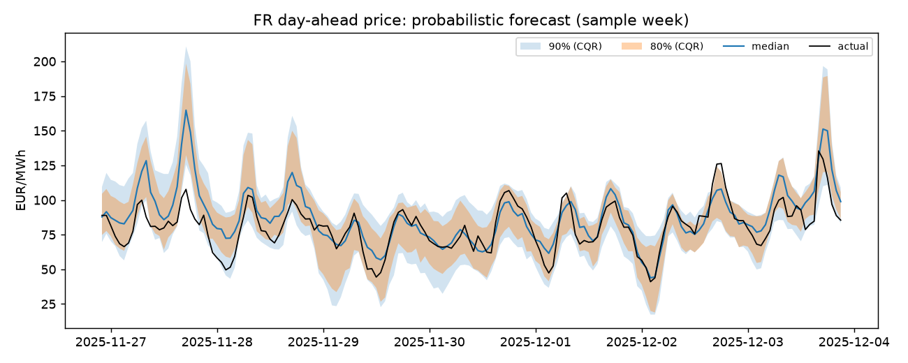
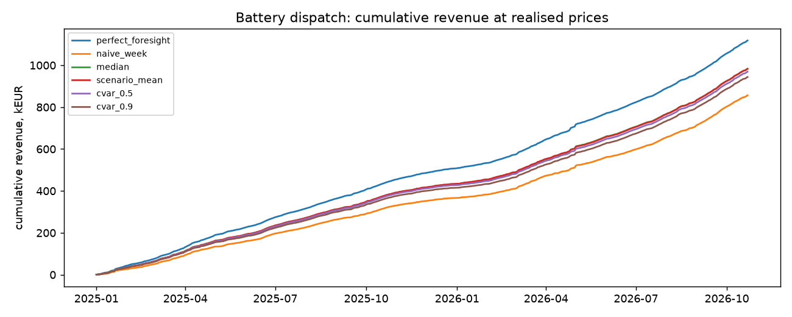

# Energy price forecasting & battery dispatch (France)

Probabilistic **day-ahead electricity price forecasting** for the French bidding zone (ENTSO-E data), followed by **LP battery dispatch** that turns the forecast distribution into a bid schedule — with an MLOps skeleton around it (MLflow tracking + model registry, pandera-validated pipeline stages, Docker, CI, Terraform for Azure).

## Problem

Every day at **12:00 CET** (gate closure) the day-ahead auction for delivery day D+1 closes. A battery operator must commit 24 hourly charge/discharge volumes *before* the 24 prices are known. Two questions:

1. What is the **distribution** of tomorrow's 24 hourly prices, given what is known at gate closure?
2. How much of the theoretical revenue (perfect foresight) can a battery capture when it optimises against that forecast, and does using the full distribution (scenarios, CVaR) beat optimising against the median?

## Architecture



Azure target (Terraform in [`infra/`](infra), **validated but never applied**): ACR, Key Vault (ENTSO-E key), Storage (Azure Files), PostgreSQL Flexible Server (MLflow DB), Container Apps environment with an **internal-only** MLflow app (no authentication, so it is not exposed publicly), a **daily Container Apps Job** running `energy infer` before gate closure, and a scale-to-zero read-only API.

## Data

* Source: ENTSO-E Transparency Platform, via [`entsoe-py`](https://github.com/EnergieID/entsoe-py).
* Target: FR day-ahead price. Features known at gate closure of day D for delivery day D+1:
  * prices up to and including delivery day D (lags 24/48/168 h, previous-day min/max/mean/std, 7/28-day means),
  * day-ahead **forecasts** of load, wind (on+offshore) and solar for D+1 and the resulting residual load,
  * lagged prices of DE-LU, BE, ES (lag ≥ 24 h only — neighbour prices for D+1 are cleared in the same auction),
  * calendar (hour, weekday, month, French public holidays, day-of-year harmonics).
* Period: 2022-01-01 → 2026-10-20 (+ tomorrow's day-ahead forecasts), hourly. Since 2025-10-01 the day-ahead market clears in 15-minute steps; those are averaged to hourly so the whole history is on one grid.
* No gas-price proxy: it needs a data source beyond the single ENTSO-E key.
* Raw data is cached per (series, month) as parquet under `data/raw/` (gitignored); only completed months are cached.

**Leakage.** [`tests/test_no_leakage.py`](tests/test_no_leakage.py) corrupts every price from delivery day D+1 onward and asserts the features of D+1 do not move, checks each lag source timestamp precedes the delivery day, and that the forecast origin is before gate closure. Caveat: ENTSO-E returns the *latest published* version of the TSO forecasts, not the vintage available at 12:00; day-ahead forecasts are occasionally revised. The reported accuracy may be slightly optimistic for that reason.

## Models and evaluation

* **QuantileGBM**: 19 LightGBM quantile regressors (τ = 0.05 … 0.95), pooled over hours (hour is a feature), sorted to avoid quantile crossing, seed 42.
* **CQR**: conformalised quantile regression (Romano et al., 2019) for the 80 % and 90 % central intervals. The correction is computed from the out-of-sample scores of the **previous three monthly folds** only, so it adapts to regime changes without peeking.
* **Baselines**: `naive_week` (same hour last week), `naive_seasonal` (yesterday for Tue–Fri, last week otherwise), `Empirical-28d` (quantiles of the same hour over the last 28 days).
* **Rolling-origin backtest**: expanding window, refit every month; fold *m* is trained on all days before *m*. Evaluated 2025-01-01 → 2026-10-22 (15,839 hourly targets). CRPS is approximated as 2 × mean pinball loss over the 19-level grid. Units: EUR/MWh.

### Results

| method            | MAE (median) | pinball | CRPS  | cov 80 % | width 80 % | cov 90 % | width 90 % |
|:------------------|-------------:|--------:|------:|---------:|-----------:|---------:|-----------:|
| naive_week        |        34.77 |       – |     – |        – |          – |        – |          – |
| naive_seasonal    |        26.88 |       – |     – |        – |          – |        – |          – |
| Empirical-28d     |        29.51 |   10.88 | 21.77 |     0.70 |      77.87 |     0.80 |      96.05 |
| QuantileGBM       |    **17.31** |    6.60 | 13.20 |     0.66 |      41.76 |     0.78 |      54.99 |
| QuantileGBM + CQR |    **17.31** |    6.60 | 13.20 |     0.80 |      54.60 |     0.89 |      72.09 |

* The GBM cuts MAE by 36 % vs. the best naive baseline and CRPS by 39 % vs. the empirical-quantile baseline.
* Raw quantiles are **over-confident** (66 % coverage for a nominal 80 % interval). CQR restores 79.5 % / 88.7 % coverage at the price of wider intervals — still 25–30 % narrower than the empirical baseline (80 %: 54.6 vs 77.9; 90 %: 72.1 vs 96.0) at equal or better coverage.
* 2026 is harder than 2025 (median MAE 20.7 vs. 14.6; price std 69 vs. 46 EUR/MWh), see `reports/results.md` and the MLflow runs.



## Battery dispatch

LP per delivery day (cvxpy + HiGHS), 10 MW / 20 MWh battery, 90 % round-trip efficiency (√0.9 each way), SoC in [10 %, 90 %], starts the day at 50 % and must end ≥ 50 %, degradation cost 4 EUR per MWh discharged. One schedule is committed per day and **revenue is evaluated at the realised prices**.

| strategy | how the schedule is chosen |
|:--|:--|
| `perfect_foresight` | LP on realised prices (upper bound) |
| `naive_week` | LP on last week's prices |
| `median` | LP on the forecast median |
| `scenario_mean` | 50 price paths sampled from the quantiles (Gaussian AR(1) copula, ρ ≈ 0.83–0.86, re-estimated each month from the PIT of earlier folds only, burn-in folds included), maximise expected revenue |
| `cvar_λ` | same scenarios, maximise (1−λ)·E[R] + λ·CVaR₂₀%[R] (Rockafellar–Uryasev), λ ∈ {0.5, 0.9} |

660 delivery days, 2025-01-01 → 2026-10-22:

| strategy          | revenue (kEUR) | EUR / MW / year | % of perfect foresight | worst-5 % day (EUR) | daily std (EUR) |
|:------------------|---------------:|----------------:|-----------------------:|--------------------:|----------------:|
| perfect_foresight |        1,118.1 |          61,834 |                  100.0 |               504.7 |           948.1 |
| naive_week        |          856.6 |          47,371 |                   76.6 |               164.0 |           916.1 |
| median            |          983.3 |          54,381 |               **87.9** |               267.4 |           928.7 |
| scenario_mean     |          987.5 |          54,614 |               **88.3** |               277.9 |           926.6 |
| cvar_0.5          |          972.1 |          53,759 |                   86.9 |               275.9 |           913.9 |
| cvar_0.9          |          945.0 |          52,262 |                   84.5 |               266.7 |           886.7 |

Takeaways (honest reading):

* The probabilistic model captures **87.9 %** of perfect-foresight revenue vs. 76.6 % for last-week prices (+11 pts).
* Using the full distribution barely moves expected revenue: the scenario schedule gains 0.4 pt over the median schedule (88.3 % vs 87.9 %) and has a better worst-5 % day (278 vs 267 EUR). Arbitrage depends mainly on the *ordering* of hours, which the median already gets right.
* CVaR trades revenue for a flatter distribution: λ = 0.5 gives 86.9 % (−1.4 pts vs. scenario_mean) with lower daily std (914 vs 927 EUR) but no better worst-5 % day (276 vs 278); λ = 0.9 over-hedges (84.5 %). In this backtest the risk-aware variants do not pay off.
* Caveats: the LP has no mutual-exclusion constraint on charge/discharge; with perfect foresight 51 of 15,839 hours (0.3 %) charge and discharge simultaneously during negative prices, which slightly overstates the upper bound. Price-taker assumption (no market impact), no intraday/balancing revenue, no capacity or ancillary-service income, fixed efficiency and SoC bounds.



## MLOps

* **MLflow** (local server via `docker compose`, SQLite backend + proxied artifacts, UI on <http://localhost:5055>). Each stage logs params/metrics/artifacts to the `fr-dayahead-price` experiment; `train` registers a `mlflow.pyfunc` model as `fr-dayahead-price-quantiles`.
* **Validation**: pandera schemas ([`schemas.py`](src/energy_forecasting/schemas.py)) guard the raw frame (value ranges, missing share, sorted unique UTC index), the feature table, and the predictions (no crossing quantiles).
* **Orchestration**: simple stages through `make` / the `energy` CLI (`ingest → features → train → backtest → dispatch → report`).
* **Inference**: `energy infer` pulls the latest data, loads `models:/fr-dayahead-price-quantiles/latest`, forecasts D+1, computes the CVaR schedule and writes `latest.json` / parquet; `energy serve` exposes the latest forecast via FastAPI (`/health`, `/forecast/latest`). Verified live against the local registry.
* **Quality**: ruff, mypy, pytest (incl. leakage tests and an end-to-end pipeline smoke test on synthetic data), pre-commit, GitHub Actions (lint, types, tests, docker build, `terraform fmt/validate`). CI never needs the ENTSO-E key. Dependencies are pinned in `uv.lock`; seeds are fixed.

## Run it

```bash
cp .env.example .env            # put your ENTSOE_API_KEY in .env (never commit it)
make setup                      # uv sync + pre-commit
make mlflow-up                  # MLflow on http://localhost:5055 (optional; falls back with a warning if down)
make pipeline                   # ingest → features → train → backtest → dispatch → report (~25 min, mostly ENTSO-E latency on first ingest)
make test-all lint types
```

macOS note: LightGBM needs OpenMP. Either `brew install libomp`, or rely on the Makefile, which points `DYLD_LIBRARY_PATH` at the libomp bundled with scikit-learn.

Terraform (validate only — nothing is created):

```bash
terraform -chdir=infra init -backend=false && terraform -chdir=infra validate
```

Postgres is opened with the `0.0.0.0` firewall rule, which allows all Azure services: acceptable for a demo; production should use VNet integration / a private endpoint. The Terraform state contains secrets (ENTSO-E key, DB password): use a remote encrypted backend (e.g. an Azure Storage account with encryption and restricted access) rather than local state.

Deploying would need `terraform apply -var subscription_id=… -var entsoe_api_key=… -var postgres_admin_password=…`, pushing the two images (`Dockerfile`, `docker/mlflow.Dockerfile`) to the created ACR, and registering a model in the deployed MLflow. This has intentionally **not** been done.

## Kubernetes (local, kind)

The same images run on Kubernetes: manifests in [`k8s/base`](k8s/base) (kustomize) — API Deployment + Service + HPA (CPU 50 %, 1–4 replicas) with readiness/liveness probes and requests/limits, MLflow Deployment + PVC, the daily `energy infer` CronJob, and the ENTSO-E key as a Secret created from the local `.env` by the script (never committed). Verified on a local kind cluster (Kubernetes v1.34): the daily job ran in-cluster against the in-cluster MLflow registry with live ENTSO-E data and the forecast was served by the API pod. Measured load test and caveats: [`docs/kubernetes.md`](docs/kubernetes.md).

```bash
scripts/k8s-up.sh          # kind cluster, images, metrics-server, Secret from .env, manifests
scripts/k8s-seed-model.sh  # register the local model.joblib in the in-cluster MLflow
kubectl -n energy create job --from=cronjob/infer infer-manual
curl http://127.0.0.1:8080/forecast/latest
scripts/k8s-down.sh
```

CI validates the rendered manifests with kubeconform (`make k8s-check` locally).

## Layout

```
src/energy_forecasting/   ingest, features, models, backtest, dispatch, pipeline, tracking, inference, api, cli
tests/                    leakage, metrics/LP/CQR, API, e2e smoke (synthetic fixtures)
infra/                    Terraform (Azure)
k8s/, scripts/k8s-*.sh    Kubernetes manifests (kustomize) + kind helpers
docs/kubernetes.md        local Kubernetes run: what was verified, load test
docker/, Dockerfile, docker-compose.yml, Makefile, .github/workflows/ci.yml
reports/                  results.md + figures
```

## Limitations / next steps

* Latest-vintage (not gate-closure-vintage) TSO forecasts; hourly aggregation of the 15-min market from Oct 2025.
* Single pooled model; no per-hour tuning or hyper-parameter search; expanding window includes the 2022 crisis.
* Dispatch is price-taker, day-by-day, without intraday re-optimisation or a binary charge/discharge exclusion.
