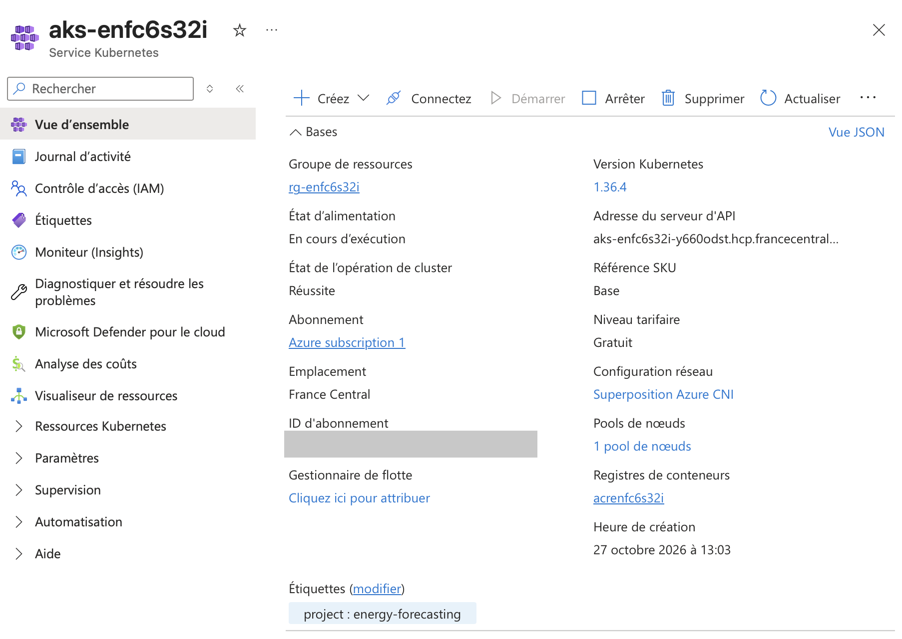

# Running on Azure (free-trial subscription, 2-day demo)

Deployed on 2026-10-27 with the Terraform in [`infra/`](../infra) (apply started 11:20 UTC), region `francecentral`, a free-trial subscription (spending limit on, $10 budget alert at 50/80/100 %). The demo is meant to be **destroyed 48 h after the apply** (deadline 2026-10-29 11:20 UTC), so the URLs below are not permanent. Cost figures: [`azure-cost-estimate.md`](azure-cost-estimate.md) (estimates from list prices; I did not get actual billed cost, the Cost Management API rate-limited my query and billing data lags).

## What was created (`terraform apply`, 24 resources)

Resource group, ACR (Basic), Key Vault (ENTSO-E key), Storage account with two Azure Files shares, PostgreSQL Flexible Server (B1ms, MLflow DB), Log Analytics (1 GB/day cap), Container Apps environment with an **internal-only** MLflow app, a **public scale-to-zero API**, a **daily Container Apps Job**, a user-assigned identity with role assignments, and a **1-node AKS cluster** (free control-plane tier).

## What was verified

| Check | Result |
|---|---|
| Images built for `linux/amd64` (the Mac builds arm64) and pushed to ACR | both pushed; ~14 min and ~11 min under emulation |
| Container Apps API `/health` | HTTP 200 |
| MLflow on Container Apps | running on Postgres (tables migrated, seen in its logs); model registered by a one-off run of the job image (MLflow is internal-only, so it cannot be reached from a laptop) |
| Daily job `energy infer` on Container Apps (manual start of the scheduled job) | **Succeeded**, 12:15:53 → 12:18:21 UTC (2 min 28 s) using the model from the Azure MLflow and live ENTSO-E data |
| Public API `/forecast/latest` | HTTP 200, delivery day 2026-10-28, 3.6 KB. After scale-to-zero the first request took **20.6 s** (cold start); then median **28.5 ms**, max 41 ms over 30 sequential requests from a Paris laptop |
| AKS | node `Standard_D2as_v7` Ready (Kubernetes v1.36, 1.9 vCPU / 5.6 GiB allocatable); same manifests applied via the overlay [`k8s/aks`](../k8s/aks); `infer` job completed in **62 s**; API behind an Azure LoadBalancer returned the forecast (HTTP 200, 71 ms) |
| AKS load test (60 s, 50 concurrent, `ab` over the public internet from the laptop) | 5,992 requests, 0 failed, ~100 req/s, p50 20 ms, p95 2.0 s, p99 3.0 s. The HPA did **not** scale (CPU 40-54 % of request, target 50 %). The tail latency looks network/connection-bound (pod CPU was low), I did not isolate the cause. These numbers are not comparable with the kind run |

## Evidence files

* AKS overview in the Azure portal (French UI; subscription ID masked): 
* `kubectl` output captured on the cluster (nodes, pods, service with the Azure LoadBalancer IP, HPA, job, volumes): [`evidence/aks-kubectl.txt`](evidence/aks-kubectl.txt)

## Things that did not go as planned

* `Standard_B2ms` is **not allowed** for AKS on this trial subscription in `francecentral` (API error listing allowed sizes). Switched to `Standard_D2as_v7` (2 vCPU / 8 GiB, $0.107/h list price).
* Container Apps jobs started with `az containerapp job start --image/--command` do **not** inherit the template's env vars; the first seeding run therefore fell back to a local MLflow and failed (`Permission denied: ./mlruns`). Re-run with explicit `--env-vars`.
* `ab` (HTTP/1.0) is rejected by the Container Apps ingress (every response was a non-2xx of 16 bytes); curl works, so I measured the Container Apps API with curl only.
* The scheduler refused to create an automatic destroy task, so the destroy has to be run explicitly (see below).
* Azure created `NetworkWatcherRG` automatically; it is not in Terraform and is not removed by `terraform destroy` (it has no cost to my knowledge).

## Teardown

```bash
terraform -chdir=infra destroy   # needs the same variables as the apply (subscription_id, entsoe_api_key, postgres_admin_password, enable_aks=true)
```

Deleting the AKS cluster also removes its `MC_*` resource group (node VM, LoadBalancer, public IP, the Azure Files share behind the `forecasts` PVC).

## AKS vs Container Apps (what I observed)

Container Apps needed no cluster management and scales to zero (at the price of a ~20 s cold start); AKS needed a RWX storage class, a LoadBalancer Service, an image pull role and node-size/quota handling, but runs the very same manifests as the local kind cluster.
